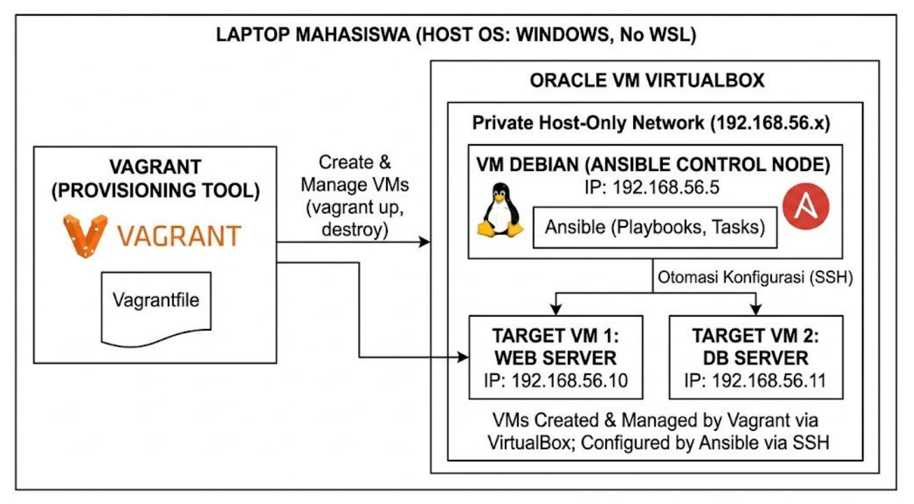

# LEMP Stack Auto-Provisioning with Vagrant & Ansible

Proyek otomasi **LEMP Stack (Linux, Nginx, MariaDB, PHP) + WordPress** dengan arsitektur
**multi-tier**: Web Server dan Database Server berjalan di VM terpisah. Seluruh
konfigurasi dilakukan otomatis oleh Ansible dari satu Control Node.

## Diagram Arsitektur



| Komponen | Peran | IP |
|---|---|---|
| Host OS (Windows) | Menjalankan VirtualBox dan Vagrant | - |
| Control Node (Debian) | Menjalankan Ansible | 192.168.56.x (DHCP Host-Only) |
| Target 1: Web Server | Nginx + PHP-FPM + WordPress | 192.168.56.10 |
| Target 2: DB Server | MariaDB | 192.168.56.11 |

## Struktur Repositori

```
.
├── Vagrantfile      # Membuat VM Web (192.168.56.10) dan DB (192.168.56.11)
├── inventory.ini    # Daftar IP target dan autentikasi SSH
├── playbook.yml     # Instalasi Nginx+PHP, MariaDB, dan WordPress
├── ansible.cfg      # Konfigurasi Ansible (host key checking dimatikan)
├── arsitektur.png   # Diagram arsitektur
└── README.md
```

## Prasyarat

Di laptop (Host):

- [VirtualBox](https://www.virtualbox.org/)
- [Vagrant](https://www.vagrantup.com/)

Control Node: sebuah VM Debian di VirtualBox dengan **Ansible** dan **sshpass**
terpasang, serta Adapter 2 bertipe **Host-only Adapter** (jaringan 192.168.56.x)
agar bisa menjangkau kedua target.

## Cara Menggunakan

**Langkah 1.** Clone repositori (di Host):

```bash
git clone https://github.com/blackenginegit/lemp-wordpress-ansible.git
cd lemp-wordpress-ansible
```

**Langkah 2.** Buat VM target (di Host, PowerShell):

```powershell
vagrant up
```

**Langkah 3.** Siapkan Control Node. Masuk ke VM Debian, lalu install Ansible dan sshpass:

```bash
sudo apt update
sudo apt install ansible sshpass -y
```

Salin `inventory.ini`, `ansible.cfg`, dan `playbook.yml` ke VM Debian, lalu pastikan
Control Node bisa menjangkau target:

```bash
ping -c 3 192.168.56.10
ping -c 3 192.168.56.11
ansible all -m ping
```

**Langkah 4.** Jalankan playbook:

```bash
ansible-playbook playbook.yml
```

## Hasil yang Diharapkan

- `PLAY RECAP` menampilkan `failed=0` dan `unreachable=0` untuk kedua server.
- Buka browser di laptop Host dan akses **http://192.168.56.10**. Halaman instalasi
  WordPress akan muncul.
- Verifikasi data tersimpan di Database Server:

```bash
ansible dbserver -b -m command -a "mysql -e 'USE wordpress; SHOW TABLES;'"
```

## Catatan Keamanan

Password database di `playbook.yml` ditulis polos untuk keperluan latihan di jaringan
lokal. Di lingkungan produksi, gunakan **Ansible Vault**.

## Studi Kasus

Penjelasan alur berpikir dan teori di balik proyek ini ada di artikel Medium:
**[Tempel tautan artikel Medium di sini]**
